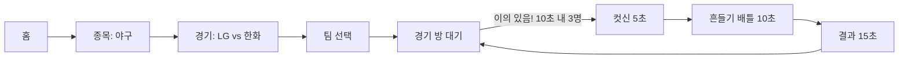

# SPEC — 이의있음! 팬심 판정 흔들기 배틀

## 0. 데모 시나리오 (이것이 MVP의 기준)
발표 데모는 **야구 · LG vs 한화** 한 경기로 진행한다.

1. 발표자가 노트북으로 `/host/kbo-lg-hh`를 띄운다 → 큰 화면에 QR, 팀별 접속자 수, 대형 게이지가 보인다.
2. 청중·심사위원이 QR로 접속 → 홈 → 야구 → `LG vs 한화 (LIVE)` → 팀 선택(LG/한화) → 경기 방 입장.
3. 방에서 "흔들기 준비" 버튼으로 센서 권한을 허용한다 (iOS 권한 팝업).
4. 발표자가 "방금 그거 오심 아니에요?!" → 모두 **[이의 있음!]** 버튼을 누른다.
5. 10초 안에 3명 이상 누르면 모든 폰과 호스트 화면에서 동시에 **컷신**이 재생된다:
   클로즈업 노려보기(2초) → 와이드 구장 벤치클리어링(2초) → **START!!** + 화면 흔들림(1초)
6. **배틀 10초**: 각자 폰을 흔든다. 흔들 때마다 화면 흔들림·타격 이펙트, 상단 줄다리기 게이지가 팀별 합산으로 실시간 이동.
7. **결과**: "팬심 판정: 오심 인정! LG 팬 승리" 같은 가짜 판정문, 팀 점수, 내 흔들기 횟수, MVP 흔들러 TOP 3.
8. 15초 뒤(또는 호스트의 [다음 판정] 버튼) 방이 대기 상태로 돌아간다.

실패 대비: 사람이 부족하면 호스트의 **[강제 판정 시작]** 버튼으로 바로 컷신을 시작한다. 센서가 안 되는 폰은 **연타 버튼**으로 참여한다.

## 1. MVP 기능과 수용 기준

| ID | 기능 | 수용 기준 (완료 조건) |
|---|---|---|
| F1 | 종목·경기·팀 선택 | 야구만 활성, 농구·배구·축구는 "준비중" 배지로 보이되 누를 수 없다. 경기 목록은 더미, `LG vs 한화`에 LIVE 표시. 팀 선택 후 `/room/:gameId`로 이동하고 team이 localStorage에 저장된다 |
| F2 | 경기 방 접속자 | 접속 시 presence 등록, 탭을 닫으면 onDisconnect로 사라진다. 팀별 접속자 수가 1초 안에 모든 폰에 반영된다 |
| F3 | 이의 있음 트리거 | 버튼을 누르면 objection 기록. 최근 10초 안의 objection 수 / 기준(3) 게이지 표시. 기준 충족 시 battle 상태가 `cutscene`으로 **한 번만** 바뀐다 (transaction) |
| F4 | 동기화된 컷신 | 모든 폰에서 서버 시각 기준 ±300ms 안에 같은 장면이 나온다. 총 5초 후 배틀로 자동 전환 |
| F5 | 흔들기 카운트 | 흔들기 1회 감지 = +1. 센서 없거나 권한 거부 시 연타 버튼 노출(탭 1회 = +1). 내 카운트는 300ms마다 DB에 저장 |
| F6 | 실시간 게이지 | 모든 참가자 카운트를 팀별로 합산해 줄다리기 게이지와 숫자로 표시. 10초 타이머 표시 |
| F7 | 결과 화면 | 승리 팀, 팀별 합계, 내 기록, MVP TOP 3(닉네임·팀·횟수), 가짜 판정문. 동점이면 "판정 보류! 재경기 요청" |
| F8 | 호스트 화면 | QR(현재 origin + `/game/kbo-lg-hh` 팀 선택 경로), 팀별 접속자, 상태별 대형 화면(대기/컷신/배틀 게이지/결과), [강제 판정 시작], [다음 판정] 버튼 |
| F9 | 픽셀 비주얼 | 모든 화면 Galmuri 폰트 + 픽셀 UI. 방·배틀 배경은 픽셀 야구장. 컷신·이펙트는 canvas 픽셀 아트 |

### 범위 밖 (발표에서 말로만 소개)
실제 경기 API 연동으로 판정 순간 자동 감지, 농구·배구·축구 실제 지원, 벤치클리어링 모드, 시즌 누적 팀 랭킹, 결과 카드 SNS 공유, 로그인.

## 2. 화면 명세

전역: 배경 짙은 남색(#1a1c2c), 픽셀 테두리 버튼(두께 4px 계단형 그림자), 폰트 Galmuri11. `image-rendering: pixelated`.

### S0 홈 `/`
- 픽셀 로고 "이의있음!" (흔들리는 애니메이션), 부제 "억울한 판정, 이제 흔들어서 따진다"
- [START] 버튼 → `/sports`

### S1 종목 선택 `/sports`
- 4개 픽셀 카드: ⚾ 야구(활성), 🏀 농구, 🏐 배구, ⚽ 축구(준비중). 이모지 대신 간단한 픽셀 아이콘이면 더 좋음
- 하단 문구 "모든 종목 지원 예정"

### S2 경기 선택 `/games/:sport`
- 더미 경기 카드 목록. 각 카드: 팀A vs 팀B(팀 컬러 블록), 상태(LIVE 깜빡임 / 예정), 접속자 수(F2 데이터)
- LIVE 경기만 선택 가능

### S3 팀 선택 `/game/:gameId`
- 좌우 큰 버튼 2개(팀 컬러 배경 + 팀 이름 텍스트)
- 닉네임 입력(선택, 비우면 `흔들왕` + 3자리 숫자 자동)
- [입장] → `/room/:gameId`

### S4 경기 방 `/room/:gameId`
- 배경: 픽셀 야구장(Stadium)
- 상단: 경기명, 팀별 접속자 수 (`LG 12명 vs 한화 9명`)
- 중앙: 거대한 픽셀 버튼 **[이의 있음!]** (누르면 버튼 눌림 + "이의 제기!" 말풍선)
- 버튼 아래: objection 게이지 `2 / 3` + 남은 시간 바(첫 objection 기준 10초)
- 하단: [흔들기 준비] (센서 권한 요청, 허용되면 "준비 완료 ✓"로 바뀜)
- battle.state가 `cutscene`이 되면 자동으로 컷신 → 배틀 화면으로 전환(같은 페이지 내 상태 전환)

### S5 컷신 (Room 내부 오버레이, 5초)
1. 0~2s **클로즈업**: 화면 대부분을 차지하는 픽셀 선수 상반신. 우리 팀 컬러 모자·유니폼(로고 없음), 무표정으로 노려보는 눈(1초마다 눈 깜빡임 1회), 배경은 초록 잔디 단색 + 약간의 노이즈. 아래에서 위로 살짝 줌인
2. 2~4s **와이드**: 위에서 내려다본 픽셀 다이아몬드 구장(잔디·흙·흰 베이스 라인·관중석 띠). 양 팀 선수(팀 컬러 점 2x3 픽셀) 각 8명이 1·3루 쪽 덕아웃에서 홈플레이트 부근으로 몰려가 뭉친다
3. 4~5s **START!!**: 큰 픽셀 글자가 튀어나오며 화면 전체가 강하게 흔들림(CSS transform 랜덤 이동 ±8px), 흰색 플래시 1프레임

### S6 배틀 (Room 내부, 10초)
- 1인칭 선수 시점: 배경 픽셀 구장, 화면 중앙 멀리 상대 팀 선수 무리(상대 팀 컬러), 화면 하단 좌우에 내 픽셀 주먹/글러브(우리 팀 컬러)
- 상단: 줄다리기 게이지(왼쪽 우리 팀 컬러, 오른쪽 상대 팀 컬러, 비율 = 팀합/(양팀합)), 팀별 합계 숫자, 남은 시간 10 → 0
- 중앙 하단: 내 횟수 큰 숫자
- 흔들기 1회마다: 화면 흔들림 150ms, 랜덤 위치에 타격 텍스트("퍽!", "쾅!", "이의!", "오심!") 400ms 페이드, 주먹이 앞으로 뻗는 2프레임 애니메이션
- 집중선(방사형 픽셀 선) 상시 회전
- 센서 미허용 시 하단에 [연타!] 큰 버튼

### S7 결과 (Room 내부)
- 상단 "팬심 판정" 픽셀 도장 애니메이션
- 판정문: 이긴 팀이 이의를 제기한 쪽인지 상관없이 랜덤 문구 중 하나
  - "오심 인정! {승리팀} 팬 승리", "원심 번복! {승리팀} 팬심 압승", "판정은 바뀌지 않지만 {승리팀} 팬은 이겼다"
- 팀별 합계, 내 횟수, MVP TOP 3
- 하단 "실제 판정은 바뀌지 않습니다 :)" 작은 글씨 (쓸데없음 포인트)
- 15초 카운트다운 후 대기 상태로 복귀

### H 호스트 `/host/:gameId` (가로 대형 화면)
- 대기: 좌측 큰 QR + "QR 찍고 참전하기", 우측 팀별 접속자 수, objection 게이지, [강제 판정 시작]
- 컷신: S5와 같은 컷신을 크게 재생
- 배틀: 대형 줄다리기 게이지 + 팀 합계 + 타이머
- 결과: 결과 화면 크게 + [다음 판정]

## 3. 유저 플로우


## 4. 데이터

### 4-1. 더미 데이터 `src/data/games.js`
```js
export const SPORTS = [
  { id: 'baseball', name: '야구', enabled: true },
  { id: 'basketball', name: '농구', enabled: false },
  { id: 'volleyball', name: '배구', enabled: false },
  { id: 'soccer', name: '축구', enabled: false },
];

export const GAMES = [
  { id: 'kbo-lg-hh', sport: 'baseball', status: 'live',
    teams: { lg: { name: 'LG', color: '#c30452', sub: '#1a1a1a' },
             hh: { name: '한화', color: '#ff6600', sub: '#1a1a1a' } } },
  { id: 'kbo-ss-kia', sport: 'baseball', status: 'scheduled',
    teams: { ss: { name: '삼성', color: '#074ca1', sub: '#ffffff' },
             kia: { name: 'KIA', color: '#ea0029', sub: '#06141f' } } },
  { id: 'kbo-dsb-lot', sport: 'baseball', status: 'scheduled',
    teams: { ds: { name: '두산', color: '#131230', sub: '#ffffff' },
             lot: { name: '롯데', color: '#041e42', sub: '#d00f31' } } },
];
```

### 4-2. Realtime Database 구조
```
rooms/{gameId}/
  presence/{uid}:   { team: 'lg', nickname: '흔들왕123', joinedAt: <serverTs> }   # onDisconnect().remove()
  objections/{uid}: { team: 'lg', at: <serverTs> }                              # 다시 누르면 at 갱신
  battle:           { state: 'idle' | 'cutscene' | 'result',
                      id: '<battleId>',
                      cutsceneAt: <ms>,   # 컷신 시작 서버 시각
                      startAt: <ms>,      # = cutsceneAt + 5000, 배틀 시작
                      endAt: <ms> }       # = startAt + 10000
  shakes/{battleId}/{uid}: { team: 'lg', nickname: '흔들왕123', count: 37 }
```
- 화면 단계 판단(클라이언트): `state==='cutscene'`이면 `serverNow()` 기준
  `< startAt` → 컷신, `< endAt` → 배틀, `>= endAt` → 결과. 결과 15초 후(`endAt + 15000`) 아무 클라이언트나 transaction으로 `idle` 리셋 + objections 삭제
- 트리거: objections를 구독하며 `at > serverNow() - 10000`인 개수를 센다. 3 이상이면 `battle`에 transaction: 현재 `idle`일 때만 `{state:'cutscene', id: push key, cutsceneAt: now+300, startAt, endAt}`로 변경
- 점수: 각자 자기 `shakes/{battleId}/{uid}`만 300ms throttle로 set. 모든 클라이언트가 `shakes/{battleId}`를 구독해 팀별 합산. `endAt` 이후 들어온 증가는 무시(클라이언트에서 기록 중단)
- 서버 시각: `.info/serverTimeOffset` 구독, `serverNow = Date.now() + offset`

### 4-3. DB 규칙 (해커톤용, 데모 후 닫기)
```json
{ "rules": { "rooms": { ".read": true, ".write": true } } }
```

### 4-4. 상수
```js
OBJECTION_WINDOW_MS = 10000
OBJECTION_THRESHOLD = 3
CUTSCENE_MS = 5000
BATTLE_MS = 10000
RESULT_MS = 15000
SHAKE_THRESHOLD = 15        // m/s², accelerationIncludingGravity 변화량
SHAKE_COOLDOWN_MS = 120
SCORE_FLUSH_MS = 300
```

## 5. 흔들기 감지 (`lib/shake.js`)
- `requestShakePermission()`: iOS면 `DeviceMotionEvent.requestPermission()` (반드시 버튼 클릭 핸들러 안에서 호출), 그 외는 바로 granted
- `startShake(onShake)`: `devicemotion`에서 `accelerationIncludingGravity`의 x,y,z 이전 값 대비 변화량 합이 `SHAKE_THRESHOLD` 초과 & 마지막 감지 후 `SHAKE_COOLDOWN_MS` 경과 시 `onShake()` 호출. 해제 함수 반환
- 3초 동안 이벤트가 하나도 안 오면 "센서 없음"으로 보고 연타 버튼 노출

## 6. 의존성
`firebase`, `react-router-dom`, `qrcode.react` 외 추가 패키지 없음.

---

## 6. 변경 사항 (v2) — 평소 응원 모드 추가

데모 시나리오 0장의 흐름은 "경기 진행 중" 안에서 이렇게 바뀐다. (이 절이 0~5장과 다르면 이 절을 따른다)

- **경기 상태**: 시작 전(`wait`) → 진행 중(`live`) → 종료(`end`). 운영자(`/admin/:gameId`)가 [경기 시작]·[경기 종료]를 누른다. 시작 전에는 "곧 시작합니다", 종료 후에는 응원 점수로 승패를 보여준다.
- **평소 응원**: 경기 중 배틀이 아닐 때는 팀을 고르고 입장한 모든 팬이 흔들기/눌러서 응원한다. 팀 응원 점수는 밀어내기 바로 보이고, 하트·야구공·응원봉 파티클이 떠오른다. 응원 화면 위쪽에 `● LIVE 팬 N명 참여`와 팀별 인원(A·B)을 보여 준다(운영자가 정한 표시 인원 가감 반영). 배경은 같은 픽셀 야구장(내 팀 색 틴트).
- **이의 있음**: 응원 화면 아래의 작은 패널. 여기에만 `n / 기준`이 나온다. 기준 인원 이상이 모이거나 운영자가 [벤치클리어링 시작]을 누르면 기존 컷신 → 배틀 → 결과가 재생되고, 끝나면 다시 응원 모드로 돌아간다.
- **운영자 조작**: 경기 시작/종료, 벤치클리어링 시작, 다음 판정, 배틀 시간, 이의 있음 발동 기준 인원, 팀별 표시 인원수 가감(연출용). 전광판(`/host/:gameId`)은 보여주기만 한다.
- **진동**: START!! 순간 3번, 배틀 종료 시 1번 크게, 흔들 때마다 짧게(안드로이드만, iOS 미지원).
- **밀어내기 바**: 응원·배틀·운영자 화면 모두 같은 부품(`pixel/PushBar.jsx`).
- **DB 추가**: `rooms/{gameId}/game`, `cheer/{runId}/{uid}`, `config/{battleMs,threshold,countAdjust/{teamId}}`.
- **메롱 놀리기**: 벤치클리어링 결과 화면(15초) 동안 **이긴 팀 팬**에게만 [메롱~] 버튼이 나온다(동점이면 없음). 연타하면 메롱 얼굴 파티클이 올라오고, 이긴 팀 색 파티클이 진 팀 폰과 전광판 화면에도 같이 올라온다. DB: `rooms/{gameId}/taunt/{battleId}/{uid} = {team, count}`.
- **휘슬 연출**: 이의 있음이 기준 인원에 도달해 판정이 시작되면 컷신 맨 앞 1.2초에 픽셀 심판이 달려 들어와 호루라기를 불고(휘슬 효과음 `whistle.mp3`, 음파선, "삐—익!") 지나간다. 그래서 컷신은 5초 → **6.2초**(`CUTSCENE_MS = 6200`)가 됐다. 이후 클로즈업 → 와이드 → START!! 순서는 그대로다.
- **경기 시작!/경기 종료! 배너**: 운영자가 경기를 시작하거나 종료하는 순간, 모든 폰과 전광판 화면 한가운데에 큰 글자("경기 시작!" 노랑 / "경기 종료!" 흰색)가 쾅 찍히고 약 1.9초 뒤 사라진다. 화면을 처음 열 때 이미 진행 중인 경기에는 뜨지 않고, 열려 있는 동안의 상태 변화에만 뜬다.
- **전광판 구성(발표용)**: 전광판(`/host/:gameId`) 한 화면에 경기 상황과 운영 조작을 같이 보여 준다. 위쪽: 상태 배지·경기 시간·접속자 수. 가운데: 팀별 큰 응원 점수 카드(앞서는 팀 표시, LIVE 팬 수)·밀어내기 바·이의 있음 게이지·QR. 오른쪽 패널: 운영 컨트롤(경기 시작/종료, 벤치클리어링 시작, 다음 판정, 인원수 조작, 배틀 시간), 응원 MVP TOP 5, 실시간 입장 알림. 운영 컨트롤은 폰용 운영자 화면(`/admin/:gameId`)과 같은 부품(`AdminControls`)이다.
- **전광판 배틀 화면 순서**: 벤치클리어링 배틀 중 전광판은 팀별 점수 카드(맨 위, 가장 크게) → 남은 시간(작게, 점수 바로 아래) → 밀어내기 바 순서로 보여 준다. 시간 숫자가 점수로 오해된다는 의견을 반영한 것이다.
- **벤치클리어링 화면 연타**: 배틀 화면은 어디를 눌러도 1회로 센다(센서가 되는 폰도 흔들기와 연타를 같이 쓸 수 있다). 하단 큰 버튼은 안내용이다.
- **모두의 파티클**: 응원·배틀 모두, 내가 누른 것뿐 아니라 참여한 모든 사람의 눌림이 파티클로 뜬다. 내 팀(같은 팀 포함)은 화면 오른쪽, 상대 팀은 왼쪽에서 올라온다(한 번 갱신에 최대 8개, 동시 30개까지).
- **아이폰 "실행 취소" 대책**: 팀 선택에서 닉네임을 입력한 페이지에서 폰을 흔들면 iOS가 "실행 취소" 창을 띄운다. 입장할 때 페이지를 새로 불러와 입력 기록이 없는 상태로 게임 화면을 연다. 그래도 뜨면 아이폰 설정 → 손쉬운 사용 → 터치 → "흔들어서 실행 취소"를 끈다.
